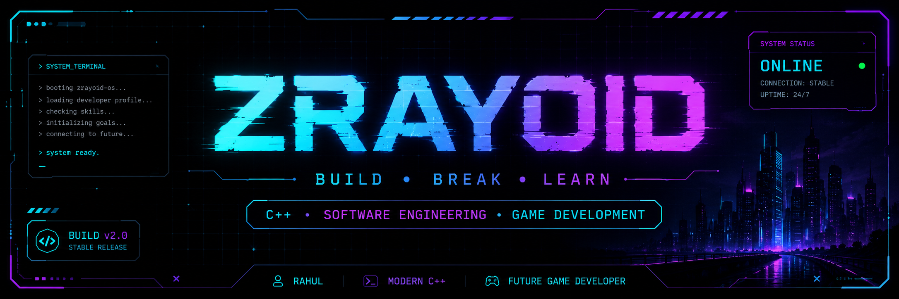

<div align="center">

<!-- If you keep your existing banner, rename it to assets/banner.png -->


# `ZRAYOID` <sub> // SYSTEM ONLINE</sub>

### C++ LEARNER · ASPIRING GAME DEVELOPER

[](https://git.io/typing-svg)

</div>

---

## `01 // TERMINAL`

```bash
$ whoami
Rahul

$ current_status
B.Sc. IT student | Programmer in progress

$ primary_quest
Game Development

$ currently_learning
Modern C++ | Object-Oriented Programming
```

## `02 // ABOUT ME`

Hey! I'm Rahul. I enjoy understanding how software works, solving problems, and building things that make me a better programmer.

I'm currently strengthening my programming foundations with Modern C++ and OOP. My long-term goal is to become a Game Developer, and this profile documents the experiments, practice, and projects along the way.

Outside code: chess ♟️ · gaming 🎮 · anime 🍥

## `03 // CURRENT MISSION`

> Live progress is generated from the `.cpp` files in this repository by the GitHub Action in `.github/workflows/update-progress.yml`.

<!-- MISSION:START -->
| CHAPTER | PROGRAMS | PROGRESS | STATUS |
|:--|--:|:--|:--|
| Variables | 10 / 10 | ██████████ 100% | COMPLETE |
| Data Types | 11 / 11 | ██████████ 100% | COMPLETE |
| Conditions | 14 / 14 | ██████████ 100% | COMPLETE |
| Loops | 5 / 5 | ██████████ 100% | COMPLETE |
| Functions | 29 / 29 | ██████████ 100% | COMPLETE |
| Arrays | 24 / 24 | ██████████ 100% | COMPLETE |
| Bitwise Operators | 12 / 12 | ██████████ 100% | COMPLETE |
| Pointers | 18 / 18 | ██████████ 100% | COMPLETE |
| OOP | 0 / 15 | ░░░░░░░░░░ 0% | WAITING FOR FIRST UPLOAD |
<!-- MISSION:END -->

**Progress rule:** completed chapters keep their historical completion caps. Future chapters use a 15-program target. Counts can exceed the cap, but the progress bar stays at 100%. The next chapter becomes active only after its first program is uploaded.

## `04 // TECH ARSENAL`

<div align="center">

<!-- GitHub README supports a horizontal icon row, but not JavaScript-powered carousel buttons or true auto-scroll. -->


<sub>Current tools and learning technologies · this row can be extended as your toolkit grows.</sub>

</div>

## `05 // FEATURED PROJECTS`

<div align="center">

<table>
<tr>
<td width="33%" align="center">

### PROJECT 01


**PROJECT LOADING**

<sub>Initializing first project...</sub>

`COMING SOON`

</td>
<td width="33%" align="center">

### PROJECT 02


**PROJECT LOADING**

<sub>Building something new...</sub>

`COMING SOON`

</td>
<td width="33%" align="center">

### PROJECT 03


**PROJECT LOADING**

<sub>Mission not yet deployed...</sub>

`COMING SOON`

</td>
</tr>
</table>

</div>


<h2 align="center">06 // GITHUB ACTIVITY</h2>

<div align="center">


<br/>


</div>


## `07 // LEARNING JOURNEY`

| STATUS | MILESTONE |
|:--|:--|
| <span style="color:#00e5ff">● COMPLETE</span> | Programming fundamentals |
| <span style="color:#00e5ff">● COMPLETE</span> | Functions, arrays and pointers |
| <span style="color:#b56cff">● IN PROGRESS</span> | Object-Oriented Programming |
| <span style="color:#777">○ NEXT</span> | Deeper C++ and problem solving |
| <span style="color:#777">○ LONG-TERM</span> | Game development |

## `08 // BEYOND THE CODE`

<div align="center">

`♟ CHESS`　 `🎮 GAMING`　 `🍥 ANIME`

</div>

## `09 // ESTABLISH CONNECTION`

<div align="center">

<a href="https://www.linkedin.com/in/rahul-kamti-53bb13362/">
  
</a>
<a href="https://github.com/Zrayoid">
  
</a>

<br />

<sub>“Every system starts with a single line of code.”</sub>

</div>
